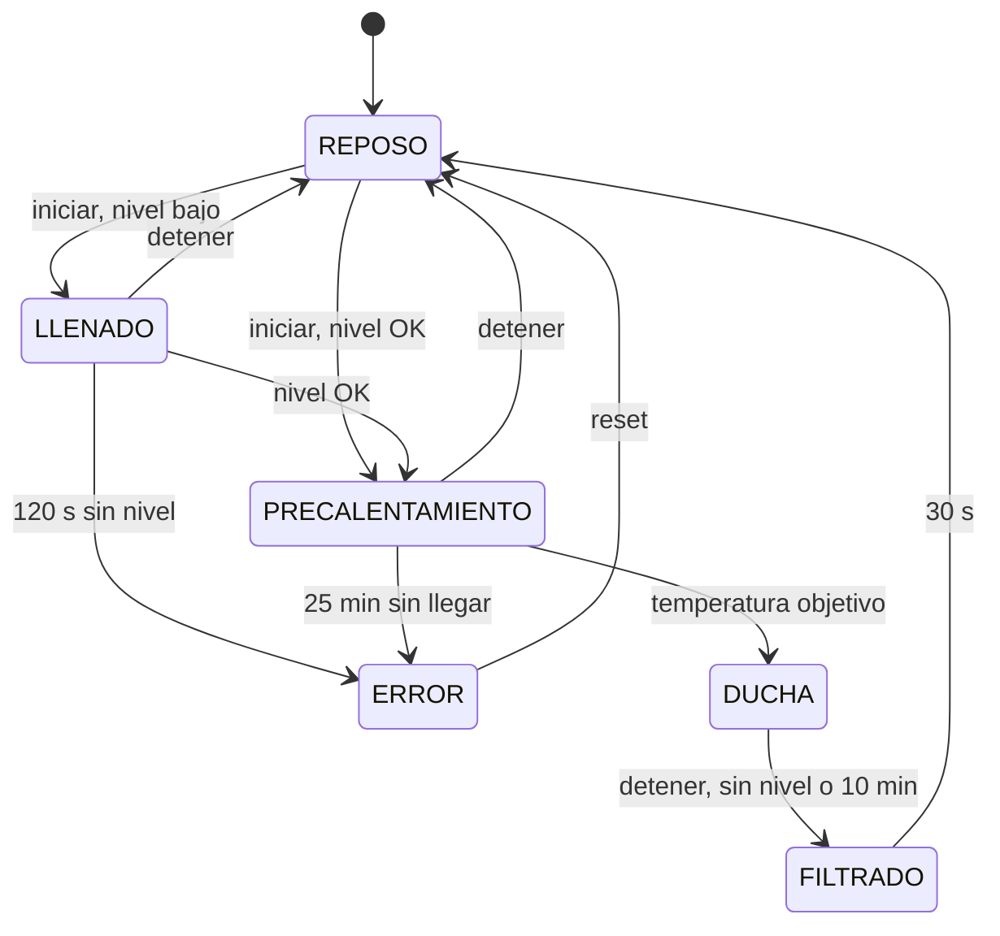
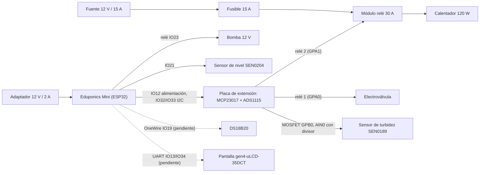

# S-PockShower

Ducha portátil con recirculación de agua y control por IoT. Proyecto de la asignatura Sistemas Basados en Computador (UPM), grupo CIM41-M14.

El firmware corre en un ESP32 con ESP-IDF y FreeRTOS. Llena un depósito, calienta el agua recirculándola, la manda a la ducha y, al terminar, mide la turbidez del agua usada para saber si el filtro está saturado. Se controla y supervisa desde ThingsBoard por MQTT y se actualiza por OTA desde las Releases de este repositorio.

## Funcionamiento

La lógica es una máquina de estados ([maquina_estados.c](main/maquina_estados.c)):



Desde cualquier estado se pasa a ERROR si salta una condición de seguridad ([seguridad.c](main/seguridad.c)) o si falla la placa de extensión.

| `estado` | Estado | Qué hace |
|---|---|---|
| 0 | REPOSO | Todo apagado, esperando `iniciar`. |
| 1 | LLENADO | Bomba encendida hasta que el sensor detecta nivel. Máximo 120 s. |
| 2 | PRECALENTAMIENTO | Recircula el agua al depósito y calienta hasta la temperatura objetivo. Máximo 25 min. |
| 3 | DUCHA | La válvula manda el agua a la ducha. El calentador mantiene la temperatura con 1 °C de histéresis. Máximo 10 min. |
| 4 | FILTRADO | Espera 30 s y mide la turbidez para decidir si el filtro está saturado. |
| 5 | ERROR | Todo apagado hasta recibir `reset`. |

| `error` | Código | Causa |
|---|---|---|
| 0 | `ERR_NINGUNO` | Sin error. |
| 1 | `ERR_TIMEOUT_LLENADO` | El depósito no se llenó en 120 s. |
| 2 | `ERR_TIMEOUT_PRECALENT` | No llegó a la temperatura objetivo en 25 min. |
| 3 | `ERR_NIVEL_BAJO` | Falta agua durante el precalentamiento. |
| 4 | `ERR_SOBRETEMP` | La temperatura llegó a 55 °C. |
| 5 | `ERR_SENSOR_TEMP` | No hay lectura de temperatura mientras se calienta. |
| 6 | `ERR_ACTUADORES` | No responde la placa de extensión. Se le corta la alimentación. |

## Hardware

### Componentes

- **STEMinds Eduponics Mini** (ESP32). Relé de la bomba, entrada de nivel y LED.
- **Placa de extensión STEMinds**, alimentada desde IO12:
  - **MCP23017** (0x27, en algunos lotes 0x20): 4 relés de 12 V en GPA0–GPA3 y MOSFET de los sensores analógicos en GPB0–GPB3.
  - **ADS1115** (0x48): 4 entradas analógicas de 16 bits.
- **Bomba** Songyi SY-DC205, 12 V y 0,25 A, sumergible. No puede funcionar en seco.
- **Electroválvula** JYZSF-4F de 3 vías, 12 V.
- **Calentador** de inmersión de 12 V y 120 W (unos 10 A). Lo conmuta un módulo de relé de 30 A, cuya entrada activa un relé de la extensión. Los relés de las placas no aguantan 10 A.
- **Sensor de nivel** DFRobot SEN0204, sin contacto.
- **Sensor de turbidez** DFRobot SEN0189. Da hasta unos 4,5 V y va al ADS1115 con un divisor de 10k/20k.
- **Sensor de temperatura** DS18B20 (OneWire).
- **Pantalla** 4D Systems gen4-uLCD-35DCT-CLB, táctil, por UART.

### Alimentación

- **Adaptador de 12 V y 2 A** (jack de la Eduponics): lógica, bomba y electroválvula. Unos 1,1 A en total.
- **Fuente independiente de 230 V a 12 V y 15 A** (toma de mechero): solo el calentador, con un fusible de 15 A.

### Conexiones

Diagrama de conexiones entre módulos. **No es el esquema eléctrico.**



### Pines

Tal como están en [config.h](main/config.h):

| Señal | Pin | Notas |
|---|---|---|
| Relé de la bomba | IO23 | Activo a nivel alto. |
| Sensor de nivel | IO21 | `NIVEL_VALOR_CON_AGUA` por comprobar con el sensor. |
| LED | IO14 | WS2812 de la placa. Ahora solo se configura como salida. |
| Alimentación de la extensión | IO12 | Pin de arranque: está en bajo durante el reset, así que la extensión arranca apagada. |
| I2C de la extensión | IO32 (SDA), IO33 (SCL) | |
| Electroválvula | MCP23017 GPA0 (relé 1) | |
| Calentador | MCP23017 GPA1 (relé 2) | Activa la entrada IN del módulo de 30 A. |
| MOSFET del sensor de turbidez | MCP23017 GPB0 | |
| Sensor de turbidez | ADS1115 AIN0 | Divisor 10k (lado sensor) / 20k (a GND). |
| DS18B20 | IO4 | **Pendiente:** en el hardware real va en IO19. |
| Pantalla | IO13 (TX), IO34 (RX) | **Pendiente:** todavía no está en el código. |

### Esquema eléctrico

Pendiente de rehacer con el hardware actual.

Diseño del anteproyecto, ya no corresponde al hardware actual: [esquema](documents/Dise%C3%B1o-electrico.png), [proyecto de EasyEDA](documents/Dise%C3%B1o-EasyEda.json), [arquitectura](documents/S_PockShower_Arquitectura.pdf) y [documento original](documents/S_PockShower_RUBEN_ORIGINAL.pdf).

## Arquitectura del software

### Módulos

| Archivo | Qué hace |
|---|---|
| [main.c](main/main.c) | Arranque: apaga los actuadores, inicia NVS, sensores, máquina de estados, OTA y Wi-Fi. |
| [maquina_estados.c](main/maquina_estados.c) | Máquina de estados, control del calentador y tarea de telemetría. |
| [seguridad.c](main/seguridad.c) | Condiciones que llevan a ERROR: sobretemperatura, sensor caído y falta de nivel. |
| [actuadores.c](main/actuadores.c) | Bomba (IO23), electroválvula y calentador (relés del MCP23017). |
| [sensor_nivel.c](main/sensor_nivel.c) | Sensor de nivel con antirrebote. |
| [sensor_turbidez.c](main/sensor_turbidez.c) | Turbidez por el ADS1115, con el MOSFET encendido solo durante FILTRADO. |
| [sensor_temperatura.c](main/sensor_temperatura.c) | DS18B20. Ahora es un stub que no devuelve lecturas. |
| [bus_i2c.c](main/bus_i2c.c) | Bus I2C compartido y alimentación de la placa de extensión. |
| [mcp23017.c](main/mcp23017.c) | Driver del MCP23017. Si falla una escritura, corta la extensión. |
| [ads1115.c](main/ads1115.c) | Driver del ADS1115 en modo single-shot. |
| [thingsboard.c](main/thingsboard.c) | Cliente MQTT: telemetría, RPC y atributos. |
| [ota.c](main/ota.c) | Actualización OTA: comprobación, descarga, vuelta atrás y planificación diaria. |
| [energia.c](main/energia.c) | Frecuencia dinámica y light sleep en REPOSO. |
| [wifi_manager.c](main/wifi_manager.c) | Wi-Fi en modo estación, portal en modo AP para configurarla y SNTP. |
| [pantalla.c](main/pantalla.c) | Pantalla. Vacío, pendiente. |
| [avisos.c](main/avisos.c) | LED y buzzer. Solo configura el LED, pendiente. |

Las constantes (pines, tiempos y umbrales) están en [config.h](main/config.h) y los tipos compartidos en [tipos.h](main/tipos.h).

### Tareas de FreeRTOS

| Tarea | Prioridad | Cuándo existe | Qué hace |
|---|---|---|---|
| `fsm_task` | 5 | Siempre | Máquina de estados. Periodo de 100 ms (1 s en REPOSO). La vigila el watchdog, que reinicia el chip si se cuelga. |
| `portal_ap` | 4 | Solo si la Wi-Fi guardada no llega a conectar | Abre el portal de configuración. Sin Wi-Fi guardada, el portal se abre directamente al arrancar. |
| `telemetria` | 3 | Siempre | Envía la telemetría sin bloquear la máquina de estados. |
| `ota_task` | 3 | Solo durante una OTA | Descarga e instala el firmware. |
| `ota_planif` | 2 | Siempre | Valida el firmware nuevo y lanza las comprobaciones de OTA. |

La Wi-Fi, MQTT y lwIP tienen sus propias tareas dentro de ESP-IDF.

## Librerías

### Componentes de ESP-IDF

| Componente | Uso |
|---|---|
| FreeRTOS | Tareas, colas, notificaciones y secciones críticas. |
| `driver` | GPIO y bus I2C (`driver/i2c_master.h`). |
| `esp_wifi`, `esp_netif`, `esp_event` | Wi-Fi y eventos de red. SNTP con `esp_netif_sntp`. |
| `nvs_flash` | Datos internos del driver de Wi-Fi y estado de la OTA. |
| `spiffs` | Archivo con las credenciales de la Wi-Fi. |
| `esp_http_server` | Portal de configuración en modo AP. |
| `mqtt` | Conexión con ThingsBoard (sin TLS, `mqtt://`). |
| `esp-tls` | HTTPS de la OTA. |
| `json` (cJSON) | Telemetría, RPC y atributos. |
| `esp_http_client`, `esp_https_ota`, `app_update` | Descarga e instalación de la OTA y vuelta atrás. |
| mbedTLS (paquete de certificados) | Certificados para HTTPS. |
| `esp_timer` | Tiempos de la máquina de estados y de la OTA. |
| `esp_pm` | Gestión de energía. |

No se usa ningún componente externo. El DS18B20 añadirá `espressif/onewire_bus` y `espressif/ds18b20` en [idf_component.yml](main/idf_component.yml).

### Drivers propios

| Driver | Qué hace |
|---|---|
| [bus_i2c.c](main/bus_i2c.c) | Alimenta la placa de extensión (IO12) y crea un único bus I2C para el MCP23017 y el ADS1115. |
| [mcp23017.c](main/mcp23017.c) | Busca el chip en 0x27 o 0x20 y escribe los puertos A (relés) y B (MOSFET). Si una escritura falla dos veces, corta la alimentación de la extensión. |
| [ads1115.c](main/ads1115.c) | Lectura single-shot a ±4,096 V y 250 muestras/s, con un tiempo máximo de espera. |

Los registros salen de los datasheets y la asignación de relés y MOSFET, del código de ejemplo de STEMinds (`micropython-eduponics`).

## Compilar y flashear

Probado con ESP-IDF v5.3.1. Necesita 5.2 o posterior.

```sh
idf.py set-target esp32
idf.py menuconfig
idf.py build
idf.py flash monitor
```

En `menuconfig`, menú **S-PockShower** ([Kconfig.projbuild](main/Kconfig.projbuild)):

| Opción | Por defecto | Qué es |
|---|---|---|
| `TB_URI` | `mqtt://mqtt.eu.thingsboard.cloud` | Broker MQTT de ThingsBoard. |
| `TB_TOKEN` | vacío | Token del dispositivo. No se sube al repositorio. |
| `OTA_URL` | Última Release de este repositorio | Binario para la OTA. |
| `OTA_HORA_DIARIA` | 3 | Hora (de Madrid) de la comprobación diaria de OTA. |
| `SHOWER_LIGHT_SLEEP` | Activado | Light sleep automático en REPOSO. |

**Borrar el `sdkconfig` local** antes de compilar si ya existía. `sdkconfig.defaults` no cambia un `sdkconfig` que ya existe, y sin borrarlo no se activan la vuelta atrás de la OTA ni la gestión de energía. Comprobar que en el `sdkconfig` nuevo aparecen `CONFIG_BOOTLOADER_APP_ROLLBACK_ENABLE=y` y `CONFIG_PM_ENABLE=y`.

El primer flasheo por USB instala también el bootloader y la [tabla de particiones](partitions.csv) (`ota_0` y `ota_1` de 1984K, SPIFFS de 64K). La OTA no los actualiza. Después de ese flasheo la placa arranca en modo AP (`ESP32_SBC26M14`) para volver a configurar la Wi-Fi.

Cada push y cada pull request se compilan en GitHub Actions ([build.yml](.github/workflows/build.yml)).

## ThingsBoard

### Telemetría

Se publica en `v1/devices/me/telemetry`. En REPOSO y ERROR, cada 60 s. En las fases activas, con la cadencia de `setCadencia` (1 s por defecto). En cada cambio de estado se envía al momento.

| Clave | Tipo | Notas |
|---|---|---|
| `temp` | número (°C) | Solo si hay lectura válida. |
| `turbidez` | número (%) | 0 = limpia, 100 = muy turbia. Solo desde la primera medida. |
| `turbidez_v` | número (V) | Tensión del sensor, para calibrar. Solo desde la primera medida. |
| `nivel_ok` | booleano | Hay agua por encima del sensor. |
| `estado` | número | Ver la tabla de estados. |
| `error` | número | Ver la tabla de errores. |
| `temp_objetivo` | número (°C) | |
| `filtro_saturado` | booleano | Resultado de la última medida de turbidez. |

### RPC

| Método | Parámetro | Qué hace |
|---|---|---|
| `iniciar` | — | Empieza una ducha (solo en REPOSO y sin OTA en curso). |
| `detener` | — | En DUCHA pasa a FILTRADO. En LLENADO o PRECALENTAMIENTO vuelve a REPOSO. |
| `setTemperatura` | número, 20–45 | Temperatura objetivo en °C. |
| `reset` | — | Sale de ERROR. |
| `setCadencia` | número, 1–3600 | Segundos entre envíos de telemetría en las fases activas. |
| `startOTA` | — | Comprueba si hay una versión nueva (solo en REPOSO). |

La respuesta es `{"status": ...}` con `ok`, `rechazado`, `comando_invalido` o `json_invalido`.

### Atributos de la OTA

| Atributo | Tipo | Qué es |
|---|---|---|
| `current_fw_title`, `current_fw_version` | Cliente | Proyecto y versión instalada. Se envían en cada conexión. |
| `fw_state` | Cliente | `DOWNLOADING`, `DOWNLOADED`, `VERIFIED`, `UPDATING`, `UPDATED` o `FAILED`. |
| `fw_error` | Cliente | Motivo cuando `fw_state` es `FAILED`. |
| `fw_title`, `fw_version`, `fw_url` | Compartido | Versión asignada desde el panel de OTA de ThingsBoard. |

En el panel de OTA de ThingsBoard, el paquete se crea con **URL externa** (la de la Release), no subiendo el archivo. Solo se aceptan URL `https://`.

## Publicar una versión por OTA

1. En una rama, subir `PROJECT_VER` en el [CMakeLists.txt](CMakeLists.txt) raíz (por ejemplo, de `1.1.0` a `1.2.0`) y fusionarla en `main`.
2. Crear la etiqueta y subirla:

   ```sh
   git switch main && git pull
   git tag v1.2.0
   git push origin v1.2.0
   ```

3. GitHub Actions comprueba que la etiqueta coincide con `PROJECT_VER`, compila y publica `S_PockShower.bin` en una Release.

Las placas instalan la versión nueva al arrancar, a la hora diaria, con `startOTA` o al asignarla desde ThingsBoard. Solo instalan versiones más nuevas que la suya. Si la versión nueva no conecta con ThingsBoard en 5 minutos con Wi-Fi, vuelve sola a la anterior y envía `fw_state: FAILED`.

No publicar nunca un binario sin cambiar la versión, ni repetir un número de versión.

## Consumo

La ducha pasa casi todo el tiempo en REPOSO. Ahí la telemetría baja a un envío por minuto, la máquina de estados a un ciclo por segundo y el chip entra en light sleep, sin perder la conexión con ThingsBoard. No se usa deep sleep porque la placa tiene que responder en todo momento a un RPC. La justificación y las estimaciones están en [politica_consumo.md](documents/politica_consumo.md).

## Pruebas con el hardware

Todo lo anterior compila, pero falta probarlo con la placa. Las pruebas pendientes, ordenadas por seguridad, están en la issue [#5](https://github.com/r-nunop/esp-shower/issues/5). El calentador no se conecta hasta haber comprobado los relés y el sensor de nivel.

## Estado actual

Hecho, sin probar en hardware:

- Actuadores con la placa de extensión, sensor de nivel y sensor de turbidez.
- Máquina de estados con desconexión de seguridad.
- ThingsBoard: telemetría, RPC y atributos.
- OTA completa con vuelta atrás.
- Gestión de consumo.

Pendiente:

- Sensor de temperatura, pantalla y avisos (de otros compañeros del grupo).
- LLENADO: si el llenado es manual, la bomba tiene que estar apagada hasta que haya nivel. Depende del montaje.
- FILTRADO: comprobar que el agua pasa por el sensor de turbidez.
- Esquema eléctrico del hardware actual.

Limitaciones conocidas:

- El portal de configuración en modo AP es abierto y guarda la contraseña de la Wi-Fi en texto plano en SPIFFS.
- Un RPC responde `ok` cuando el comando entra en la cola, no cuando se ejecuta.
- La conexión MQTT con ThingsBoard no va cifrada: el token del dispositivo viaja en claro.

## Autores

- Mario Reyes Morales
- Lucas Rojas Tena
- David Sánchez Sánchez
- Rubén Nuño Peña

